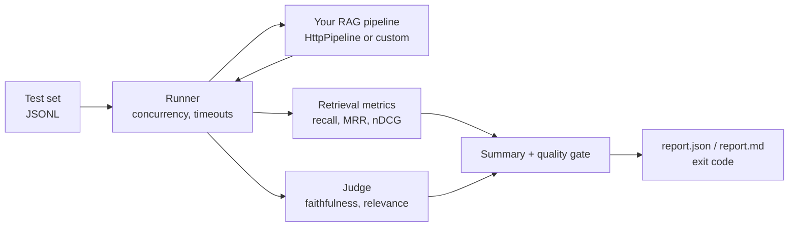

# ragprobe

**Evaluate any RAG pipeline from the command line.** Retrieval metrics, LLM-as-judge scoring, and a CI quality gate that fails the build when answer quality regresses.

- **Pipeline-agnostic.** Point it at any HTTP endpoint, or implement one small interface in-process.
- **Free and offline.** The optional judge runs on a local model through [Ollama](https://ollama.com). No API keys.
- **Zero runtime dependencies.** Only Node.js 20+.
- **Built for CI.** Exit codes, thresholds, and a Markdown report that shows up on the GitHub Actions run page.

```text
$ ragprobe run --dataset examples/dataset.jsonl --endpoint http://localhost:4010/query --k 3 --min-recall 0.6

## ragprobe report

**Quality gate: passed**

| Metric | Value |
| --- | --- |
| recall@3 | 72.2% |
| MRR@3 | 0.778 |
| nDCG@3 | 0.735 |
| latency p50 / p95 | 21ms / 82ms |

### Weakest cases

| Case | Recall | MRR | Faithfulness | Note |
| --- | --- | --- | --- | --- |
| `secure-account` | 0.0% | 0.00 | – |  |
| `download-data` | 0.0% | 0.00 | – |  |
```

The bundled demo pipeline uses keyword retrieval, and the report shows exactly where that breaks: paraphrased questions ("make my login more secure") miss the right document. That is the point of the tool: it turns "the RAG feels worse" into a number and a list of cases.

## Quick start

```bash
npm install
npm run example:server        # terminal 1: a tiny deterministic RAG service
npm run example:eval          # terminal 2: evaluate it
```

### With an LLM judge (local, free)

Start Ollama in Docker. On first start, the `models` service pulls the judge model into a cached volume:

```bash
npm run ollama:up          # NVIDIA GPU
npm run ollama:up:cpu      # no GPU (slower)
npm run ollama:logs        # watch the model download
```

Then evaluate with the judge:

```bash
npm run dev -- run --dataset examples/dataset.jsonl --endpoint http://localhost:4010/query \
  --judge ollama --judge-model qwen3:8b --min-faithfulness 0.7
```

To pull different models, set `JUDGE_MODELS="qwen3:8b llama3.2:3b" npm run ollama:up`. A native Ollama install works too; ragprobe only needs `http://localhost:11434`.

An 8B model at 4-bit quantisation with an 8k context fits on an 8 GB GPU. On smaller machines, use `llama3.2:3b`. To confirm the GPU is in use, run `docker compose exec ollama ollama ps`: the PROCESSOR column should read `100% GPU`.

## How it works



### Dataset format

One JSON object per line. `#` lines are comments.

```json
{"id": "refund-window", "question": "How many days do I have to request a refund?", "relevantDocIds": ["refund-policy"], "referenceAnswer": "Within 30 days.", "tags": ["billing"]}
```

Every problem in the file is reported at once, with line numbers, before any request is sent.

### Pipeline contract

```http
POST /query  {"question": "..."}
→ {"answer": "...", "contexts": [{"id": "refund-policy", "content": "...", "score": 0.82}]}
```

Different response shape? Pass `mapResponse`, or skip HTTP entirely:

```ts
import { runEvaluation, loadDataset, checkGate, type RagPipeline } from 'ragprobe';

const pipeline: RagPipeline = {
  name: 'my-pipeline',
  async query(question, { signal }) {
    const docs = await retriever.search(question, { signal });
    return { answer: await generate(question, docs), contexts: docs };
  },
};

const report = await runEvaluation(await loadDataset('eval.jsonl'), { pipeline, k: 5 });
console.log(checkGate(report.summary, { minRecall: 0.8 }));
```

## Metrics

| Metric | Question it answers |
| --- | --- |
| recall@k | Of the documents that matter, how many did we retrieve? |
| precision@k | How much of the context window is useful? |
| hit rate@k | Did we retrieve at least one useful document? |
| MRR@k | How high is the first useful document ranked? |
| nDCG@k | How good is the whole ranking? |
| faithfulness | Is every claim in the answer supported by the context? (judge) |
| relevance | Does the answer address the question? (judge) |

## Design decisions

- **Retrieval and generation are scored separately.** When quality drops, you need to know whether the retriever or the generator caused it. Retrieval metrics are pure, deterministic functions. Only answer quality needs a model.
- **Duplicate document IDs count once.** Pipelines often return several chunks of one document. Counting each chunk would inflate precision and nDCG.
- **The judge scores on a 1–5 scale, normalised to 0–1.** Small models are noticeably more consistent with a short integer scale than with free-form floats. The request uses Ollama's structured output (JSON schema) and temperature 0. A tolerant parser and retries handle what slips through.
- **One failing case never aborts a run.** Pipeline and judge errors are recorded per case and counted in the summary (`--max-error-rate`). Each call has its own timeout, and Ctrl-C cancels in-flight requests through `AbortSignal`.
- **Dependencies are injected.** `fetch`, the clock, the pipeline, and the judge can all be swapped, so the test suite runs in about 2 seconds with no network.
- **No runtime dependencies.** Argument parsing is `node:util`, tests are `node:test`, and validation is a small hand-written parser that reports every issue at once.

## CLI

```text
ragprobe run --dataset <file> --endpoint <url> [options]

  --k <n>                 rank cutoff (default 5)
  --concurrency <n>       parallel requests (default 4)
  --timeout <ms>          per-call timeout (default 30000)
  --header "k: v"         extra request header, repeatable
  --judge ollama          enable the LLM judge
  --judge-model <name>    default qwen3:8b
  --min-recall / --min-mrr / --min-ndcg / --min-faithfulness / --min-relevance / --max-error-rate
  --out <dir>             default ./reports
```

Exit codes: `0` passed, `1` quality gate failed, `2` usage or runtime error.

## Development

```bash
npm test           # node:test via tsx
npm run typecheck
npm run build
```

## Roadmap

- [ ] HTML report with per-tag breakdown
- [ ] Baseline comparison (`--compare reports/main.json`) to flag regressions in PRs
- [ ] Response cache so re-runs only call the judge for changed answers
- [ ] OpenAI-compatible judge adapter (llama.cpp server, vLLM, LM Studio)

## License

MIT
