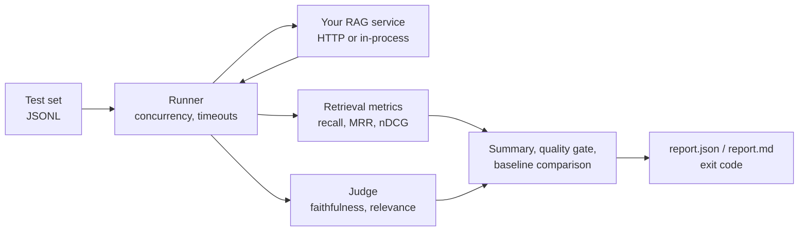

# ragprobe

[](https://github.com/Toxxxu/ragprobe/actions/workflows/ci.yml)
[](LICENSE)

**Automated tests for AI assistants that answer from your documents.**

Your chatbot answers questions from your help centre, wiki, or contracts. ragprobe tells you when it finds the wrong documents or makes things up, before your users do, and fails the build when a change makes it worse.

- **Finds the weak spots.** Scores retrieval (did it find the right documents?) and answers (are they supported and on topic?), and lists the exact questions that fail.
- **Catches regressions.** Compare any two runs and block a pull request when quality drops.
- **Writes the test set for you.** Point it at a folder of documents and it drafts realistic questions.
- **Free and offline.** The judge model runs locally through [Ollama](https://ollama.com). No API keys, and your documents never leave your machine.
- **Works with any stack.** Anything that answers an HTTP request: LangChain, LlamaIndex, the OpenAI API, or your own code.

```text
$ ragprobe run --dataset examples/dataset.jsonl --endpoint http://localhost:4010/query --judge ollama --min-recall 0.6

## ragprobe report

**Quality gate: passed**

| Metric | Value |
| --- | --- |
| recall@5 | 72.2% |
| MRR@5 | 0.778 |
| faithfulness | 94.4% (9 judged, 0 errors) |
| relevance | 55.6% |

### Weakest cases

| Case | Recall | MRR | Faithfulness | Relevance | Note |
| --- | --- | --- | --- | --- | --- |
| `secure-account` | 0.0% | 0.00 | 100.0% | 0.0% | The answer is faithful as it does not make any claims beyond what is known. However, it is irrelevant because it does not address the question about making a lo... |
| `refund-speed` | 100.0% | 1.00 | 100.0% | 0.0% | The answer is fully faithful to the context, as it correctly states the 30-day refund window. However, it is irrelevant to the question about when the refund wi... |
```

The demo service uses simple keyword search, and the report shows exactly where that breaks: "How can I make my login more secure?" never finds the two-factor authentication page, and "When will my refund arrive?" gets a true answer to a different question.

## Who it is for

- **Teams shipping a RAG chatbot or search assistant** who want to know whether a prompt, model, or chunking change made it better or worse.
- **Engineers choosing between models or embeddings** who need numbers instead of impressions.
- **Regulated or privacy-sensitive teams** that need evidence the assistant sticks to the source documents, without sending data to a third party.

## Quick start

Requires Node.js 20+ and [pnpm](https://pnpm.io).

```bash
pnpm install
pnpm run example:server        # terminal 1: a small demo RAG service on port 4010
pnpm run example:eval          # terminal 2: evaluate it
```

### Add the answer judge (local, free)

Start Ollama in Docker. The first start downloads the judge model (about 5 GB) into a cached volume:

```bash
pnpm run ollama:up          # NVIDIA GPU
pnpm run ollama:up:cpu      # no GPU (slower)
pnpm run ollama:logs        # watch the download
```

Then evaluate with the judge:

```bash
pnpm run dev run --dataset examples/dataset.jsonl --endpoint http://localhost:4010/query \
  --judge ollama --min-faithfulness 0.7
```

The first run loads the model into memory, which can take a few minutes. It stays loaded for 30 minutes. An 8B model fits on an 8 GB GPU; on smaller machines use `--judge-model llama3.2:3b` and pull it with `JUDGE_MODELS="llama3.2:3b" pnpm run ollama:up`. A native Ollama install works too.

## Generate a test set from your documents

Writing test questions by hand is the slowest part of evaluation. ragprobe drafts them from a folder of `.md`, `.mdx`, or `.txt` files:

```bash
pnpm run dev generate --docs path/to/docs --out eval.jsonl --per-doc 3
```

Questions are phrased the way users talk, not copied from the documents, and every second one describes only the user's situation. On the demo documents, keyword search finds 56–63% of them while an embedding retriever finds all of them, so the set separates weak retrieval from good retrieval like a handwritten one.

Each document's ID is its path without the extension (`docs/billing/refunds.md` → `billing/refunds`), so your service must return the same IDs in `contexts`. Generated questions are a starting point: read them, delete weak ones, and add the questions your real users ask.

## Catch regressions

Save a baseline, then compare every change against it:

```bash
ragprobe run ... --out reports/main                                      # on main
ragprobe run ... --baseline reports/main/report.json --max-drop 0.05     # on a branch
ragprobe compare reports/main/report.json reports/branch/report.json     # any two runs
```

Here the keyword-search demo is the baseline and the [LangChain example](examples/integrations), which uses embeddings, is the new run:

```text
| Metric | Baseline | Now | Change |
| --- | --- | --- | --- |
| recall@5 | 0.722 | 1.000 | +0.278 ▲ better |
| MRR@5 | 0.778 | 1.000 | +0.222 ▲ better |
| faithfulness | 0.944 | 1.000 | +0.056 ▲ better |
| relevance | 0.500 | 1.000 | +0.500 ▲ better |

### Cases that got better (6)
- `refund-speed`: relevance 0% → 100%
- `secure-account`: recall@5 0% → 100%, relevance 0% → 100%
- `download-data`: recall@5 0% → 100%, relevance 0% → 100%
- …
```

`--max-drop 0.05` exits with code 1 when any metric worsens by more than 0.05.

## Use it in GitHub Actions

```yaml
- name: Start your RAG service
  run: docker compose up -d my-rag-service

- uses: Toxxxu/ragprobe@v0.2.0
  with:
    dataset: eval/dataset.jsonl
    endpoint: http://localhost:8000/query
    args: --k 5 --min-recall 0.8 --min-mrr 0.6
```

The report appears on the run's summary page, and the step fails when a threshold is missed. Outputs `report-json` and `report-markdown` give the file paths for later steps.

## Connect your pipeline

ragprobe sends one request per question:

```http
POST /query  {"question": "..."}
→ {"answer": "...", "contexts": [{"id": "refund-policy", "content": "...", "score": 0.82}]}
```

Ready-made servers for **LangChain**, **LlamaIndex** and the **OpenAI API** are in [examples/integrations](examples/integrations). A different response shape can be converted with `mapResponse`, and Node.js code can skip HTTP entirely:

```ts
import { runEvaluation, loadDataset, checkGate, type RagPipeline } from 'ragprobe';

const pipeline: RagPipeline = {
  name: 'my-pipeline',
  async query(question, { signal }) {
    const docs = await retriever.search(question, { signal });
    return { answer: await generate(question, docs), contexts: docs };
  },
};

const report = await runEvaluation(await loadDataset('eval.jsonl'), { pipeline, k: 5 });
console.log(checkGate(report.summary, { minRecall: 0.8 }));
```

### Dataset format

One JSON object per line. Lines starting with `#` are comments.

```json
{"id": "refund-window", "question": "How many days do I have to request a refund?", "relevantDocIds": ["refund-policy"], "referenceAnswer": "Within 30 days.", "tags": ["billing"]}
```

Every problem in the file is reported at once, with line numbers, before any request is sent.

## Metrics

| Metric | Question it answers |
| --- | --- |
| recall@k | Of the documents that matter, how many did it find? |
| precision@k | How much of what it found is useful? |
| hit rate@k | Did it find at least one useful document? |
| MRR@k | How high is the first useful document ranked? |
| nDCG@k | How good is the whole ranking? |
| faithfulness | Is everything in the answer supported by the documents? (judge) |
| relevance | Does the answer fully address the question? (judge) |

## How it works



## Design decisions

- **Retrieval and answers are scored separately.** When quality drops, you need to know whether search or generation caused it. Retrieval metrics are pure, deterministic functions; only answer quality needs a model.
- **Faithfulness and relevance are independent.** A true but incomplete answer is faithful and only partially relevant; "I don't know" is faithful and not relevant. The judge prompt spells this out with worked examples, because small models otherwise blur the two.
- **The judge scores on a 1–5 scale, normalised to 0–1.** Small models are more consistent with a short integer scale. Requests use structured output (a JSON schema) and temperature 0, and a tolerant parser with retries handles the rest.
- **Duplicate document IDs count once.** Pipelines often return several chunks of one document, and counting each would inflate precision and nDCG.
- **One failing case never aborts a run.** Errors are recorded per case and counted in the summary (`--max-error-rate`). Every call has its own timeout, and Ctrl-C cancels requests in flight.
- **No runtime dependencies.** Argument parsing is `node:util`, tests are `node:test`, and `fetch`, the clock, the pipeline and the judge are all injectable, so the test suite runs offline in about a second.

## CLI

```text
ragprobe run --dataset <file> --endpoint <url> [options]
  --k <n>                      rank cutoff (default 5)
  --concurrency <n>            parallel requests (default 4)
  --timeout <ms>               per-call timeout (default 30000)
  --header "k: v"              extra request header, repeatable
  --judge ollama               enable the answer judge
  --judge-model <name>         default qwen3:8b
  --judge-load-timeout <ms>    time allowed to load the model (default 600000)
  --min-recall / --min-mrr / --min-ndcg / --min-faithfulness / --min-relevance / --max-error-rate
  --baseline <report.json>     compare with an earlier run
  --max-drop <0..1>            fail when any metric worsens by more than this
  --out <dir>                  default ./reports

ragprobe compare <baseline.json> <current.json> [--max-drop <0..1>]

ragprobe generate --docs <dir> --out <file.jsonl> [--per-doc <n>] [--model <name>] [--force]
```

Exit codes: `0` passed, `1` quality gate or regression check failed, `2` usage or runtime error. Run `ragprobe <command> --help` for every option.

## Development

```bash
pnpm test
pnpm run typecheck
pnpm run build
```

## Roadmap

- [ ] HTML report with a per-tag breakdown
- [ ] Response cache so re-runs only judge answers that changed
- [ ] OpenAI-compatible judge (llama.cpp server, vLLM, LM Studio)

## Work with me

I build and evaluate RAG systems. If your assistant gives wrong answers or you need a quality gate before release, I can help you measure where it fails and fix it: test set design, retrieval tuning, and CI setup.

Get in touch through my GitHub profile, [@Toxxxu](https://github.com/Toxxxu), or open an issue.

## License

MIT
